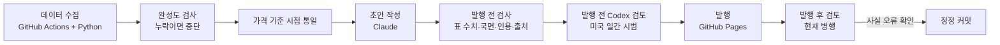

# 미국·한국 증시 일간 브리프 | fdo2a.github.io

장 마감 데이터를 코드로 수집하고, AI로 작성한 브리프를 여러 단계로 검증한 뒤 발행하는 개인 리서치 프로젝트입니다. 2026년 7월부터 매 거래일 운영하고 있습니다. 미국·한국 일간 브리프를 중심으로 일본 시장 브리프와 메모리 반도체 3사 점검을 함께 발행합니다.

이 프로젝트에서 가장 공을 들인 부분은 **어떤 오류를 코드로 검증할 수 있고, 무엇은 아직 검증하지 못하는지 구분하는 일**입니다. 검증 가능한 숫자는 발행 전에 대조하고, 코드가 놓치는 문장과 해석은 별도 검토 대상으로 남깁니다.

## 발행물

**[웹사이트 fdo2a.github.io](https://fdo2a.github.io/)** · 2026-11-05 기준

| 발행물 | 기준 | 편수 |
|---|---|---|
| [미국 일간 브리프](posts/) | 전 거래일 미국장 마감, 한국 시간 오전 발행 | 80 |
| [한국 일간 브리프](kr/posts/) | 당일 한국장 마감, 평일 저녁 발행 | 63 |
| [미국 주간](weekly/) · [한국 주간](kr/weekly/) | 한 주 정리 | 9 · 7 |
| [뉴스·산업 브리프](news/) | 미국 일간과 함께 발행 | 27 |
| [일본 일간](japan/daily/) · [일본 주간](japan/posts/) | 도쿄 마감. 주간은 「일본이 금리 정상화를 이어갈 수 있나」 한 질문 | 6 · 5 |
| [메모리 반도체 점검](thesis/) | 삼성전자·SK하이닉스·마이크론. 투자 논거가 바뀐 날만 갱신 | 3개 종목 |
---

## 1. 시스템 구조

세 가지 원칙으로 움직입니다.

1. **AI는 시세·금리를 임의로 찾지 않습니다.** 숫자는 코드가 정해진 출처에서 모은 파일을 바탕으로 씁니다. 웹 검색은 시황 동인·지표 일정·산업 뉴스를 파악하는 리서치 단계에 쓰고, 결과는 별도 파일(`research_notes.md`)로 전달합니다.
2. **수치가 어디에 쓰였는지까지 확인합니다.** 미국 일간의 주요 시장 표는 행·열에 해당하는 원자료 값과 단위·기준일을 대조합니다. 불일치는 고친 뒤 다시 검사하며, 해결되지 않은 발행 게이트 위반이 남으면 발행하지 않습니다. 이 방식이 모든 본문 숫자에 적용되는 것은 아닙니다.
3. **검증하지 못한 부분은 구분해 남깁니다.** 문장 속 수치와 해석에는 자동 검사의 사각지대가 있습니다. 미국 일간에는 발행 전 Codex 교차 검토를 시범 도입했고, 현재 발행 후 검토도 병행합니다. 발행 전 Codex 검토가 실패해도 그 사실을 기록하고 기존 검증을 통과한 초안으로 발행할 수 있습니다.

**데이터 출처**

| 시장 | 데이터 | 출처 |
|---|---|---|
| 미국 | 국채 금리 | 네이버 증권 (FRED·Yahoo Finance는 대체·대조용) |
| 미국 | 경제지표 | FRED 공식 API |
| 미국 | 경제지표 발표 원문 | BLS, BEA, Census 등 발표 기관 |
| 미국 | 주요 지수, 원자재, 환율 | Yahoo Finance |
| 한국 | 국고채 금리, 기준금리 | 한국은행 ECOS API |
| 한국 | 증시 수급, 업종별 데이터 | 네이버 증권 |
| 일본 | 닛케이 지수 종가 | 닛케이 공식 CSV (Yahoo Finance 시세와 0.01% 이내 대조) |
| 일본 | 국채 금리 | 일간은 네이버 증권 (안 되면 일본 재무성 고시 금리로 표 전체 대체), 주간은 일본 재무성 |
| 일본 | 단기 금리, 경제지표 | 일본은행 API |
| 일본 | 해외 증권 투자 자금 흐름 | 일본 재무성 |
| 메모리 3사 | 주가, 컨센서스 EPS, P/E·P/B | Yahoo Finance |
| 메모리 3사 | 공시 | DART (삼성전자·SK하이닉스), SEC EDGAR (마이크론) |

---

## 2. 핵심 설계 결정

운영하면서 실제로 부딪힌 문제와, 그에 맞춰 바꾼 설계입니다.

### 숫자를 나열하는 대신, 판단의 순서를 정한다

미국 일간의 전략 코멘트는 **사건 → 시장에 주는 의미 → 대응 → 이 판단이 틀렸다고 볼 조건** 순서로 씁니다. 매크로 섹션은 고용·경기활동·소비·물가 네 축을 데이터로 평가하고, 정책금리 기대가 바뀌는지 살핀 뒤 자산가격에 미치는 경로를 설명합니다. 전달 경로는 실질금리, 최종수요, 달러·상대금리, AI 설비투자 네 갈래로 나눕니다.

틀과 데이터 판정 규칙은 제가 정했고, 서술 초안은 AI가 작성합니다. 반증 조건을 적게 하는 것과 실제 투자 판단이 맞는 것은 별개이므로, 정해 둔 시점에 결과를 다시 확인합니다.

- [미국 일간 운영 기준](scripts/us/CLAUDE.md) · [매크로 판단 검사](scripts/us/macro_gate.py)

### 데이터가 빠지면 채우지 않고 멈춘다

장 마감 후 GitHub Actions가 데이터를 수집하면 필수 항목(주요 지수, 섹터, 국채 4개 만기, 환율, 원자재)의 누락과 기준일을 검사합니다. 빠졌거나 날짜가 어긋난 항목은 `missing`에 기록하고 발행을 멈춥니다. 다른 날짜의 값이나 추정치로 대신 채우지 않습니다.

- [완성도 검사 `completeness()`](https://github.com/fdo2a/fdo2a.github.io/blob/15bf30a3aac96db5be5958b437f355dffc25a6a6/scripts/collect_market_data.py#L732) · [수집 워크플로](.github/workflows/collect-market-data.yml) · [실행 기록](https://github.com/fdo2a/fdo2a.github.io/actions)

### 가격과 등락률의 기준 시점을 맞춘다

2026년 10월 13일 브리프를 읽은 외부 평가자가 「10/12 Brent 105.70에서 10/13 106.27로 올랐는데 등락률이 -0.36%」라는 모순을 짚었습니다.

원인을 추적해 보니 표의 가격은 **수집 시각(뉴욕 20:34)의 시간외 거래가**였고, 등락률은 **전일 결제가** 대비로 계산돼 있었습니다. 10/12 Brent 결제가는 106.65였습니다. 같은 날 WTI 등락률은 기준에 따라 +0.43%(결제가)에서 +1.44%(16:00 ET)까지 세 배 차이가 났습니다. 환율 일봉도 ECB 기준환율과 날짜가 어긋나 있었습니다.

그래서 원자재와 환율을 **30분봉에서 뉴욕 16:00 ET 값을 잘라 쓰도록** 바꿨습니다. 수집 시각과 상관없이 같은 값이 나오고, 미국 주식 마감과 같은 시점입니다. 결제가를 쓰지 않은 이유는 수집 경로에서 금요일 결제가를 다음 세션이 열리는 일요일 저녁에야 받을 수 있고, CME 공식 자료는 자동 수집이 금지돼 있기 때문입니다. 선물은 연속 티커 대신 해당 월물 티커를 씁니다.

- [`close_cut.py`](scripts/us/close_cut.py) (파일 상단에 경위 기록) · [설계 문서](docs/superpowers/specs/2026-10-14-close-cut-basis.md)

### 판단을 매일 새로 그리지 않는다

초기 브리프는 전날 글을 기억하지 못하고 매일 그날 등락에서 판단을 처음부터 다시 만들었습니다. 7월 24일부터 8월 14일까지 주식 판단은 「비중축소」와 「리스크온」 사이를 오갔고, 7월 30일에는 마이크론 하루 +18% 급등에 판단 전체가 뒤집혔습니다. 독자는 그것이 국면 변화인지 표현 변화인지 구분할 수 없었습니다.

지금은 경기 국면 판단(성장 × 물가 3×3 격자, 정해진 이름 9개)을 전날 값에서 이어받습니다. **국면을 움직일 수 있는 것은 가격이 아니라 새 경제지표 발표뿐이고**, 하루에 한 축 한 칸만, 바꾼 뒤 5영업일은 다시 키울 수 없습니다. 판단을 낮추는 쪽은 언제든 허용합니다. 또 「무엇이 나오면 이 판단이 틀린 것인가」를 본문에 밝히게 했습니다. 검증 스크립트가 발행본의 국면 표식을 허용 범위와 대조해 어긋나면 발행을 막습니다.

- [`macro_gate.py`](scripts/us/macro_gate.py) · [매크로 논리 승계 설계](docs/superpowers/specs/2026-08-18-us-macro-logic-persistence-design.md) · [발단이 된 스탠스 지속성 설계](docs/superpowers/specs/2026-08-17-us-multiasset-stance-persistence-design.md)

### 휴일이 낀 주에도 가짜 숫자를 만들지 않는다 (일본)

일본 주간 브리프는 미·일 2년 금리차가 한 주 동안 얼마나 움직였는지 계산합니다. 처음에는 두 나라 금리 이력에서 날짜가 겹치는 날만 골라 뺐습니다. 첫 발행 전에 일본 연휴(2026년 9월 21-23일)가 낀 주로 돌려 보니 겹치는 날이 사라져 주간 변화가 「0」으로 나왔습니다. 오류 메시지가 아니라 그럴듯한 숫자로 나온다는 점이 문제였습니다.

지금은 두 금리 각각의 최신 값을 쓰고 두 기준일을 함께 표기합니다. 같은 원칙으로, 일본 국채 금리를 네이버와 재무성 두 출처에서 받을 때는 **두 출처를 섞어 변동폭을 계산하지 않습니다.** 두 출처는 금리 정의가 달라 같은 날에도 최대 7.5bp 차이가 납니다. 한쪽이 안 되면 표 전체를 다른 쪽으로 바꿉니다.

- [일본 주간 설계](docs/superpowers/specs/2026-09-26-weekly-insight-and-japan-design.md) · [일본 일간 국채 금리 설계](docs/superpowers/specs/2026-10-29-japan-daily-naver-jgb.md) · [`scripts/japan/`](scripts/japan/)

### 바뀐 게 없는 날은 아무것도 쓰지 않는다 (메모리 반도체)

메모리 3사 점검은 일간 브리프와 반대로 설계했습니다. 투자 논거는 매일 바뀌지 않으므로, **새 트리거가 없는데 페이지가 바뀌면 검증에서 발행을 막습니다.** 「보통은 아무것도 하지 마」라는 지시는 프롬프트만으로는 지켜지지 않아서 상태 파일과 검사로 강제했습니다.

- **등급은 정해진 네 단계**(홀딩 강화 · 주의 · 비중 조절 검토 · kill condition)이고, 하루에 한 단계만 움직입니다. 악화는 바로 반영하고 회복은 3영업일을 기다립니다. kill condition은 가격과 계약·점유율이 함께 깨질 때만 씁니다.
- **등급을 움직이는 것은 1차 출처뿐입니다.** 공시·IR·실적 자료로 확인된 사건만 근거가 되고, 언론 단독 보도나 익명 소식통은 「추론」으로만 적습니다. 공시는 평일마다 DART와 SEC EDGAR에서 같은 기준으로 분류해 수집합니다.
- **컨센서스 변화는 직접 쌓습니다.** Yahoo Finance는 오늘 컨센서스만 주기 때문에, 30일 동안 추정치가 어떻게 바뀌었는지는 매일 한 줄씩 기록해야만 알 수 있습니다.
- **밸류에이션은 목표주가가 아니라 기준선입니다.** 정규화 이익법과 자산법을 함께 쓰고, 가정이 결과를 좌우한다는 점을 페이지에 밝힙니다. 최근 실적이 데이터에 아직 반영되지 않아 P/B가 높아 보여도 손으로 고치지 않고 기준일을 표시합니다.

- [메모리 점검 설계](docs/superpowers/specs/2026-08-24-thesis-watch-design.md) · [조용한 날 판정](docs/superpowers/specs/2026-09-24-thesis-quiet-prefilter.md) · [마이크론 SEC 공시 수집](docs/superpowers/specs/2026-10-17-sec-edgar-micron-feed.md) · [`scripts/thesis/`](scripts/thesis/)

### 검토를 사람의 기억에 맡기지 않는다

Codex는 로컬에서만 돌아서, 클라우드에서 자동 발행되는 브리프 앞에 끼울 수 없습니다. 그래서 검토를 발행 뒤로 옮기고 미검토 발행본을 원장에 기록하게 했습니다. 그런데 2026년 9월 10일 원장을 재 보니 발행에서 검토까지 **중앙값 6일**이 걸리고 있었습니다. 「몇 시간 미검토」를 예상한 설계였습니다.

지금은 로컬 러너가 매시간 미검토 발행본을 Codex에 읽힙니다. 그 지적을 Claude가 원자료와 대조해, 근거 파일과 본문이 어긋나는 사실 오류만 정정합니다. 정정은 원격 저장소의 임시 복제본에서 하고, 러너가 수정 범위와 원장을 검사한 뒤에만 반영합니다. 해석이 갈리는 지적과 근거 날짜가 맞지 않는 지적은 사람에게 넘깁니다.

2026년 11월 7일에는 미국 일간에 **발행 전 Codex 교차 검토** 절차를 추가했습니다. 초안과 근거를 읽고 사실관계·과도한 인과 주장·번역투를 지적하면, 기존 작성 절차가 근거를 다시 확인해 수정 여부를 결정합니다. 수정본은 발행 게이트를 다시 통과해야 합니다. **첫 실제 발행 적용은 11월 10일 예정**이므로 운영 효과를 입증한 단계는 아닙니다. 현재는 검토가 실패하거나 제한시간을 넘겨도 실패 사유를 남기고 원래 검증본을 발행할 수 있으며, 발행 후 러너가 다시 확인합니다.

- [발행 전 검토 설계](docs/superpowers/specs/2026-11-07-prepub-codex-review.md) · [발행 전 검토 실행 기준](.claude/PREPUB_REVIEW.md)
- [발행 후 검토 설계](docs/superpowers/specs/2026-08-24-post-publish-review-gate-design.md) · [로컬 검토 러너 설계](docs/superpowers/specs/2026-09-10-local-review-runner-design.md)

---

## 3. 검증 체계와 한계

### 미국 일간: 숫자의 '존재'가 아니라 '자리'를 확인한다

초기 검사는 본문 수치가 수집한 데이터 어딘가에 있는지만 확인했습니다. 하지만 2026년 11월 5일 리포트의 정상 수치 467개를 하나씩 끝자리만 바꿔 넣자, **64%가 기존 검사를 그대로 통과**했습니다. 대조 대상 데이터에 값이 22,187개나 있어, 잘못 쓴 숫자도 우연히 다른 항목과 일치한 것입니다.

11월 7일부터는 미국 일간의 주요 시장 표 6종에 한해, 각 칸이 가리키는 **자산·항목·기간·단위·데이터 값**을 지정해 대조합니다. 반올림은 원자료에서 표시 자릿수로 한 번만 적용하며, 알 수 없는 행이나 빠진 행도 검사합니다.

실제 발행본 26편(2026-10-01~11-05)에 수치 오타를 인위적으로 넣고 다시 시험한 결과는 다음과 같습니다.

| 변형 시험 대상 | 검출 결과 | 의미 |
|---|---:|---|
| 주요 시장 표 칸 | **191 / 191 (100%)** | 이 시험에서 표 오타를 모두 검출 |
| 문장 및 기타 수치 | **46 / 1,369 (약 3%)** | 문장 숫자의 자동 대조 범위는 아직 좁음 |

이 결과는 **과거 글에 인위적으로 만든 오타를 넣은 시험 성적**입니다. 실제 발행물의 모든 오류를 100% 막는다는 뜻은 아닙니다. 문장 속 숫자는 자산과 항목이 명확할 때만 대조하고, 나머지는 '미검증'으로 기록합니다. 현재는 문장 수치에 경고를 내고 최소 5개를 별도 표본 대조하며, 11월 21일에 다시 측정한 뒤 차단 여부를 결정할 계획입니다. 이 검사의 적용 범위는 **미국 일간**이며, 한국·일본 리포트에는 같은 수준의 전수 대조를 적용했다고 주장하지 않습니다.

- [수치 대조 구현 `number_audit.py`](scripts/us/number_audit.py) · [실행 명령 `check_numbers.py`](scripts/check_numbers.py) · [측정과 설계 기록](docs/superpowers/specs/2026-11-07-number-audit.md)

### 발행 전 자동 검증

| 검증 | 확인하는 것 |
|---|---|
| [수치 `check_numbers.py`](scripts/check_numbers.py) | 미국 일간 주요 시장 표의 칸별 수치·단위·날짜 대조. 본문 수치는 일부 판정, 나머지는 미검증으로 집계 |
| [매크로 `macro_gate.py`](scripts/us/macro_gate.py) | 경기 판단에 쓴 수치, 새 지표 없이 국면 판단이 바뀌지 않았는지 |
| [연준 발언 `fed_gate.py`](scripts/us/fed_gate.py) | 인용한 발언이 수집한 원문에 글자 그대로 있는지 |
| [출처 `check_sources.py`](scripts/check_sources.py) | 본문 링크가 그날 수집한 문서를 가리키는지 |

이 밖의 검사는 [`scripts/`](scripts/)의 `check_*.py`에 있습니다. 초안 작성 규칙은 [작성 지침](.claude/agents/brief-report-writer.md)과 [실행 절차](.claude/ORCHESTRATOR.md)에 있습니다.

### 자동 검증이 못 하는 것

표의 수치는 이제 **해당 칸에 들어가야 하는 데이터**와 대조하지만, 본문 문장의 숫자와 인과관계까지 모두 검증하지는 못합니다. 예를 들어 개별 금리는 맞는데 '2년물만 상승'이라고 요약하면 표 검사만으로는 놓칠 수 있습니다. 또한 경제 해석의 타당성은 자동 검사를 통과해도 보장되지 않습니다.

이 때문에 발행 후 Codex 검토를 운영하고, 미국 일간은 발행 전 검토도 시범 적용하고 있습니다. Codex 지적도 사실로 간주하지 않고 반드시 원자료와 비교해 정정·기각·보류합니다. 검토 기록은 [`reviews/index.json`](reviews/index.json)에, 지적별 판단 근거는 검토 커밋 메시지에 남깁니다.

**사례**

- [2026-10-26 정정](https://github.com/fdo2a/fdo2a.github.io/commit/9ed54cb) — 국채 금리 변동을 「2년물만 상승」이라고 썼지만 실제로는 2년물과 5년물이 함께 올랐습니다. 개별 수치는 모두 맞았고 그것을 묶은 문장이 틀린, 자동 검증이 못 잡는 전형적인 경우입니다.
- [2026-11-03 검토](https://github.com/fdo2a/fdo2a.github.io/commit/fe3d2bb) — Codex 지적 5건을 원자료와 대조해 모두 기각하거나 보류했습니다. 검토자의 지적도 그대로 받아들이지 않습니다.
- [정정 이력 전체](https://github.com/fdo2a/fdo2a.github.io/commits/main?search=정정)

---

## 4. 저장소 안내

GitHub Pages 사이트와 자동화 코드가 한 저장소에 있습니다. 사이트 경로는 공개 URL이라 옮기지 않습니다.

**코드와 기록**

| 디렉터리 | 내용 |
|---|---|
| [`docs/`](docs/) | 설계 문서와 결정 이력 — [읽는 순서 안내](docs/README.md) |
| [`scripts/`](scripts/) | 수집·검증·조판 코드. `us/`·`kr/`·`common/`·`review/` 등 모듈별 |
| [`data/`](data/) · [`kr/data/`](kr/data/) | 수집한 시장 데이터, `history/`에 날짜별 이력 |
| [`research/`](research/) | 미국·한국 투자 가설과 근거 원장 |
| [`reviews/`](reviews/) | 발행 후 검토·정정 원장 |
| [`.claude/`](.claude/) | AI 작성 지침과 실행 절차 |
| [`.github/workflows/`](.github/workflows/) | 데이터 수집 GitHub Actions |

**사이트 발행 경로**

| 디렉터리 | 내용 |
|---|---|
| `posts/` · `kr/posts/` | 미국·한국 일간 |
| `weekly/` · `kr/weekly/` | 미국·한국 주간 |
| `news/` | 뉴스·산업 브리프 |
| `japan/` | 일본 일간·주간 |
| `thesis/` | 메모리 반도체 3사 점검 |
| `assets/` | 발행 이미지 |

---

본 프로젝트에서 발행하는 자료는 정보 제공을 목적으로 하며, 특정 금융상품에 대한 투자 권유가 아닙니다.
